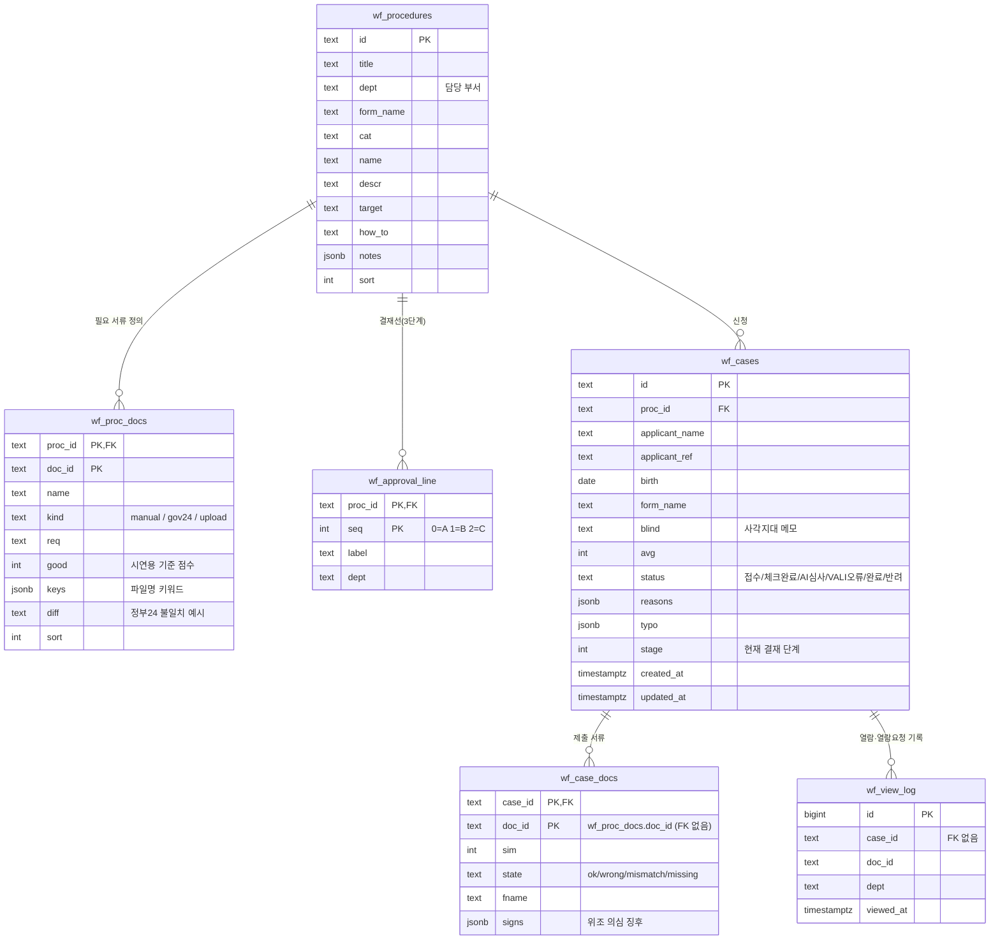

# ERD (Supabase `wf_` 테이블)

## 참고
- `wf_case_docs.doc_id`는 `wf_proc_docs(proc_id, doc_id)`를 논리적으로 가리키지만 FK로 걸려 있지 않습니다.
- `wf_view_log.case_id`도 FK가 없습니다. 신청 건을 삭제해도 열람 기록은 남습니다.
- 모든 데이터는 시연용 합성 데이터입니다.
